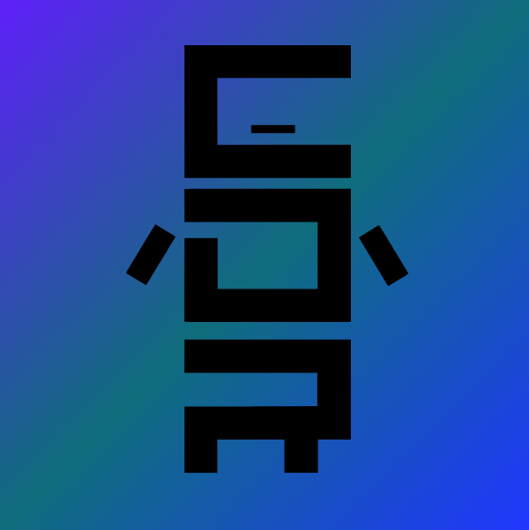

# Hermes



Panel de control web para manejar un robot con **ESP32** desde el navegador, usando un joystick en pantalla y **Bluetooth Low Energy (BLE)**. No necesita instalar nada: es una página estática (HTML, CSS y JavaScript).

Hecho por [Fabrilez05](https://github.com/Fabrilez05) y el Club de Robótica de la FP-UNA. Comparte el estilo visual del [showcase del congreso](https://github.com/Fabrilez05/CDR-showcase-congreso).

## Cómo se usa

1. Abre la página en un navegador compatible (ver más abajo).
2. Pulsa **Connect BLE** y elige tu ESP32 en la lista de dispositivos.
3. Arrastra la palanca. Los ejes **X** e **Y** se envían al robot mientras la mueves.
4. Al soltarla, la palanca vuelve al centro y se envía `0.00` en ambos ejes, así el robot se detiene.
5. Pulsa **Disconnect BLE** para cerrar la conexión.

## Compatibilidad

Hermes usa la API **Web Bluetooth**, que no está en todos los navegadores:

| Navegador | Funciona |
|-----------|----------|
| Chrome / Edge en Windows, macOS, Linux y Android | Sí |
| Safari y cualquier navegador en iOS | No |
| Firefox | No |

La página debe abrirse por **HTTPS** (por ejemplo GitHub Pages) o desde `localhost`. Si la abres con doble clic como archivo local, Chrome puede bloquear el Bluetooth.

## Protocolo BLE

Hermes busca un dispositivo que anuncie este servicio y escribe en esta característica:

| Dato | Valor |
|------|-------|
| Service UUID | `d3f8007e-c032-43ef-90f7-b042e9910fff` |
| Characteristic UUID | `f85ba695-b4ec-42cf-8127-1c08d2fbce99` |

Cada movimiento se envía como texto, con `writeValueWithoutResponse`:

```
X:0.35,Y:-0.80
```

- `X` e `Y` van de **-1.00 a 1.00**, con dos decimales.
- `X` positivo es derecha; `Y` positivo es adelante.
- `X:0.00,Y:0.00` significa palanca en reposo.

### En el ESP32

El ESP32 debe crear un servidor BLE con ese servicio y esa característica (con permiso de escritura sin respuesta), y anunciar el UUID del servicio. Al recibir el texto, puedes leer los dos valores así:

```cpp
float x, y;
sscanf(valor.c_str(), "X:%f,Y:%f", &x, &y);
```

Si cambias los UUID en el firmware, cámbialos también en `joystick.js` (constantes `serviceUUID` y `characteristicUUID`).

## Archivos

```
.
├── index.html       # estructura de la página
├── style.css        # estilo "papel técnico" con modo oscuro
├── joystick.js      # lógica del joystick y conexión BLE
└── LogoCDRazul.png  # logo del club
```

## Probarlo en tu computadora

No hay dependencias. Sirve la carpeta con cualquier servidor local, por ejemplo:

```
python3 -m http.server 8000
```

y abre `http://localhost:8000` en Chrome o Edge.

## Publicarlo con GitHub Pages

En el repositorio: **Settings → Pages → Source: Deploy from a branch → `main` / `(root)`**. Pages entrega la página por HTTPS, que es lo que necesita Web Bluetooth.

## Personalizar

- **Colores y tipografía:** las variables están al inicio de `style.css` (`--tinta`, `--fondo`, `--acento`…).
- **Alcance de la palanca:** `maxDistance` en `joystick.js` (75 px por defecto).
- **Fuente del título:** se carga desde Google Fonts. Sin internet cae a la fuente del sistema.
